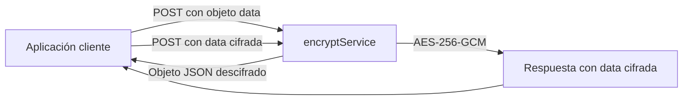

<div align="center">

# encryptService

**Una capa común para cifrar e intercambiar payloads JSON sensibles.**

Java 17 · Spring Boot 3 · AES-256-GCM · REST

</div>

---

## El problema

En producción, algunos desarrollos estaban devolviendo información sensible en texto claro. Además del riesgo de exposición, cada aplicación podía terminar resolviendo el cifrado de forma distinta.

`encryptService` centraliza esa operación: recibe un objeto JSON y devuelve un único valor cifrado en `data`. Las aplicaciones consumidoras integran un contrato común para proteger sus payloads antes de entregarlos a otros componentes.

El cifrado es una capa adicional de protección. No sustituye HTTPS, autenticación, autorización ni controles de acceso a los datos.

## La solución

El servicio serializa el objeto JSON y lo cifra usando **AES-256-GCM**. Para cada operación genera un IV aleatorio de 12 bytes y lo empaqueta con el contenido cifrado y su etiqueta de autenticación en una cadena Base64. La API mantiene un solo campo `data`; el IV y la clave no se exponen como campos separados.

Hay una clave para las integraciones entre servicios y otra para el front web. El front incluido consume su propio conjunto de rutas.



## Stack

| Área | Tecnología |
| --- | --- |
| Lenguaje | Java 17 |
| Framework | Spring Boot 3.4.3 |
| API | Spring Web y REST |
| Validación | Jakarta Bean Validation |
| Cifrado | AES-256-GCM, IV de 12 bytes, etiqueta de 128 bits |
| Serialización | JSON con Jackson |
| Front de demostración | HTML, CSS y JavaScript |
| Build | Maven |

## API

La API escucha en el puerto `8081`.

### Integraciones entre servicios

#### Cifrar — `POST /cryptoService/encrypt`

Solicitud:

```json
{
  "data": {
    "customerId": "CUST-1042",
    "accountStatus": "ACTIVE"
  }
}
```

Respuesta:

```json
{
  "data": "<payload-cifrado-en-base64>"
}
```

#### Descifrar — `POST /cryptoService/decrypt`

Solicitud:

```json
{
  "data": "<payload-cifrado-en-base64>"
}
```

Respuesta:

```json
{
  "data": {
    "customerId": "CUST-1042",
    "accountStatus": "ACTIVE"
  }
}
```

### Front web

El front de demostración usa rutas con una clave separada:

- `POST /cryptoService/web/encrypt`
- `POST /cryptoService/web/decrypt`

Abre [https://encryptService.dotacioneszambrano.com/](https://encryptService.dotacioneszambrano.com/) para usar la interfaz web.

## Formato e interoperabilidad

El campo `data` cifrado es `Base64(IV || ciphertext || tag)`: los primeros 12 bytes decodificados son el IV; el resto contiene el texto cifrado y la etiqueta GCM de 128 bits.

Para interoperar desde otro lenguaje, usa AES/GCM/NoPadding, la clave de 32 bytes correspondiente y el mismo orden de bytes.

## Ejecución local

Requisitos:

- JDK 17
- Maven 3.6 o superior

`application.properties` incluye el perfil `secrets`. Crea un archivo `application-secrets.yml` en la raíz del proyecto con dos claves AES-256 distintas, codificadas en Base64:

```yaml
crypto:
  aes:
    service-key: "<clave para integraciones>"
    web-key: "<clave distinta para el front>"
```

Genera cada clave de forma independiente:

```bash
openssl rand -base64 32
```

El archivo `application-secrets.yml` está excluido de Git.

Cambiar el puerto de ejecucion en el `application.properties` por el 8081

Inicia la aplicación desde la raíz del proyecto:

```bash
mvn spring-boot:run
```


## Estructura

```text
src/main/java/com/example/encryptservice/
├── EncryptServiceApplication.java
├── controller/CryptoController.java
└── service/SymmetricCryptoService.java

src/main/resources/
├── application.properties
└── static/index.html
```

## Autor

**Jhonatan Zambrano**  
[GitHub](https://github.com/jhonatan0820) · [jhonizam2023@gmail.com](mailto:jhonizam2023@gmail.com)
